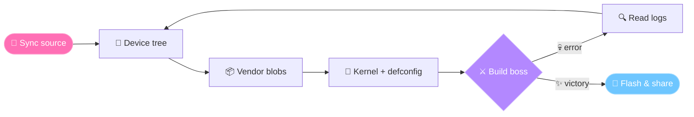

<p align="center">
  <picture>
    <source media="(prefers-color-scheme: dark)" srcset="https://readme-typing-svg.demolab.com?font=Fira+Code&weight=600&size=24&duration=2800&pause=800&color=FF9ECD&center=true&vCenter=true&width=720&height=50&lines=Konnichiwa%21+I%27m+HiSiuDz+%28%E2%89%A7%E2%96%BD%E2%89%A6%29%2F;Android+ROM+Tinkerer+%E2%9C%A6+Linux+Nerd;Powered+by+coffee+%26+anime+%E2%98%95%F0%9F%8D%A5;Let%27s+build+something+cool+%D9%A9%28%E2%97%95%E2%80%BF%E2%97%95%29%DB%B6">
    
  </picture>
</p>

<!-- Muốn thêm ảnh/gif anime của bạn: bỏ comment dòng dưới và thay link ảnh
<p align="center"></p>
-->

<p align="center">
  
  
  
</p>

<p align="center">
  <a href="https://t.me/noobbuildxyz"></a>
  <a href="https://t.me/HiSiuDz"></a>
</p>

<p align="center">✦ ･ﾟ: *✧･ﾟ:* ✦ ･ﾟ: *✧･ﾟ:* ✦</p>

<p align="center"></p>

```text
╔══════════════════════════════════════════════╗
║   ✦ ═══════  S T A T U S  ═══════ ✦          ║
╠══════════════════════════════════════════════╣
║  Name    : HiSiuDz                           ║
║  Title   : 「Android ROM Tinkerer」           ║
║  Origin  : Vietnam 🇻🇳                        ║
║  Class   : ROM Dev / Linux Nerd              ║
║  Guild   : NoobBuild (Telegram)              ║
║  Weapons : C · C++ · Bash · Python           ║
║  Passive : Turns coffee into code ☕          ║
║  Mood    : (ᵔᴥᵔ) ready to build              ║
╚══════════════════════════════════════════════╝
```

<p align="center">✦ ･ﾟ: *✧･ﾟ:* ✦ ･ﾟ: *✧･ﾟ:* ✦</p>

<p align="center"></p>



<p align="center">✦ ･ﾟ: *✧･ﾟ:* ✦ ･ﾟ: *✧･ﾟ:* ✦</p>

<p align="center"></p>

<table align="center">
  <tr>
    <td align="center" width="33%">
      <h3>📱 Android ROM</h3>
      <sub>Device trees · vendor blobs<br>building & bringing up custom ROMs</sub>
    </td>
    <td align="center" width="33%">
      <h3>🐧 Linux & Kernel</h3>
      <sub>Low-level internals · kernel configs<br>build tooling & automation</sub>
    </td>
    <td align="center" width="33%">
      <h3>⚡ C / C++ / Bash</h3>
      <sub>System-level code · scripts<br>small, useful tools</sub>
    </td>
  </tr>
</table>

<p align="center">✦ ･ﾟ: *✧･ﾟ:* ✦ ･ﾟ: *✧･ﾟ:* ✦</p>

<p align="center"></p>

<details open>
<summary><b>Languages</b></summary>
<br>
<p>
  
  
  
  
  
  
</p>
</details>

<details open>
<summary><b>Platforms & Tools</b></summary>
<br>
<p>
  
  
  
  
  
  
  
  
  
  
</p>
</details>

<p align="center">✦ ･ﾟ: *✧･ﾟ:* ✦ ･ﾟ: *✧･ﾟ:* ✦</p>

<p align="center"></p>

<p align="center">
  <picture>
    <source media="(prefers-color-scheme: dark)" srcset="https://streak-stats.demolab.com/?user=Huy7684&hide_border=true&background=1a1226&ring=FF6FB5&fire=FF9ECD&currStreakLabel=FF9ECD&currStreakNum=ffffff&sideNums=ffffff&sideLabels=e8def8&dates=b8a9d0">
    
  </picture>
</p>

<p align="center">
  
</p>

<p align="center">✦ ･ﾟ: *✧･ﾟ:* ✦ ･ﾟ: *✧･ﾟ:* ✦</p>

<p align="center">
  <b>頑張って！ Ganbatte!</b> (ﾉ◕ヮ◕)ﾉ*:･ﾟ✧<br>
  <i>"Talk is cheap. Show me the code." — Linus Torvalds</i>
</p>


