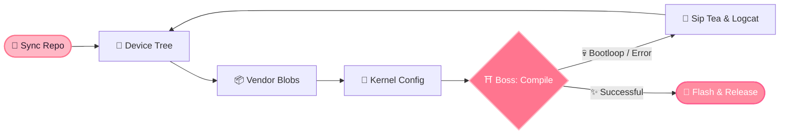

  <picture>
    <source media="(prefers-color-scheme: dark)" srcset="[https://readme-typing-svg.demolab.com?font=Fira+Code&weight=600&size=22&duration=2600&pause=800&color=FFB7C5&center=true&vCenter=true&width=750&height=45&lines=%E3%81%8A%E3%81%AF%E3%82%88%E3%81%86+~+Konnichiwa!+I'm+HiSiuDz+(%E2%89%A7%E2%97%95%E2%80%BF%E2%97%95%E2%89%A6)%E2%9C%BF;Forging+Custom+ROMs+%26+Taming+Linux+Kernels+%F0%9F%8C%B8;Powered+by+Caffeine,+Anime+%26+Sakura+Breeze+%E2%98%95%F0%9F%8D%A1;Let's+compile+some+magic+together!+%D9%A9(%CB%8A%E3%83%AD%CB%8B*)%D9%88](https://readme-typing-svg.demolab.com?font=Fira+Code&weight=600&size=22&duration=2600&pause=800&color=FFB7C5&center=true&vCenter=true&width=750&height=45&lines=%E3%81%8A%E3%81%AF%E3%82%88%E3%81%86+~+Konnichiwa!+I'm+HiSiuDz+(%E2%89%A7%E2%97%95%E2%80%BF%E2%97%95%E2%89%A6)%E2%9C%BF;Forging+Custom+ROMs+%26+Taming+Linux+Kernels+%F0%9F%8C%B8;Powered+by+Caffeine,+Anime+%26+Sakura+Breeze+%E2%98%95%F0%9F%8D%A1;Let's+compile+some+magic+together!+%D9%A9(%CB%8A%E3%83%AD%CB%8B*)%D9%88)">
    
  </picture>

  
  
  
  
  

🌸 ━━━ ･ﾟ: *✧･ﾟ:* ━━ ❀ ━━ *:･ﾟ✧*:･ﾟ ━━━ 🌸

<h3 align="center">🌸 『 ステータス ・ Adventurer Status 』 🌸</h3>

<table align="center" width="100%">
  <tr>
    <td width="52%" valign="top">
      <h4 align="center">📜 Character Sheet</h4>
<pre>
╭─── ❀ ─── S A K U R A   S T A T U S ─── ❀ ───╮
  ✦ Player   : HiSiuDz (Huy)
  ✦ Title    : 「ROM Alchemist / Kernel Weaver」
  ✦ Realm    : Vietnam 🇻🇳
  ✦ Guild    : NoobBuild (Telegram)
  ✦ Elements : C · C++ · Bash · Python
  ✦ Passive  : [Sakura Blossom] Coffee ➔ Code ☕
  ✦ Ultimate : Zero-Error Compilation ✨
  ✦ Status   : (ﾉ◕ヮ◕)ﾉ*:･ﾟ✧ Ready for Raid!
╰─────────────────────────────────────────────╯
</pre>
    </td>
    <td width="48%" valign="top">
      <h4 align="center">⚔️ Class Mastery & Equipment</h4>
      <ul>
        <li><b>📱 Android ROM Sorcery:</b> Device trees · Vendor blobs · Custom ROM bring-up</li>
        <li><b>🐧 Linux & Kernel Ninjutsu:</b> Low-level internals · Defconfigs · Build automation</li>
        <li><b>⚡ System Scripting:</b> C/C++ native tools · Bash scripts · CI/CD pipelines</li>
      </ul>
      

         
        
      

    </td>
  </tr>
</table>

🌸 ━━━ ･ﾟ: *✧･ﾟ:* ━━ ❀ ━━ *:･ﾟ✧*:･ﾟ ━━━ 🌸

<h3 align="center">🌸 『 クエスト ・ The ROM Building Ritual 』 🌸</h3>

🌸 ━━━ ･ﾟ: *✧･ﾟ:* ━━ ❀ ━━ *:･ﾟ✧*:･ﾟ ━━━ 🌸

<h3 align="center">🌸 『 戦歴 ・ Battle Record & Contributions 』 🌸</h3>

  <picture>
    <source media="(prefers-color-scheme: dark)" srcset="[https://streak-stats.demolab.com/?user=Huy7684&hide_border=true&background=2B192E&ring=FF758F&fire=FFB7C5&currStreakLabel=FFB7C5&currStreakNum=ffffff&sideNums=ffffff&sideLabels=FFD1DC&dates=D4A5B8&border_radius=12](https://streak-stats.demolab.com/?user=Huy7684&hide_border=true&background=2B192E&ring=FF758F&fire=FFB7C5&currStreakLabel=FFB7C5&currStreakNum=ffffff&sideNums=ffffff&sideLabels=FFD1DC&dates=D4A5B8&border_radius=12)">
    
  </picture>
  <picture>
    <source media="(prefers-color-scheme: dark)" srcset="[https://github-readme-stats.vercel.app/api?username=Huy7684&show_icons=true&hide_border=true&bg_color=2B192E&title_color=FFB7C5&icon_color=FF758F&text_color=ffffff&border_radius=12](https://github-readme-stats.vercel.app/api?username=Huy7684&show_icons=true&hide_border=true&bg_color=2B192E&title_color=FFB7C5&icon_color=FF758F&text_color=ffffff&border_radius=12)">
    
  </picture>

  

 

  <b>「 桜のように散り、コードのように生きる 」</b> 
  <i>"Talk is cheap. Show me the code." — Linus Torvalds</i>  
  <b>頑張って！ Ganbatte!</b> (ﾉ◕ヮ◕)ﾉ*:･ﾟ✧ 🌸

