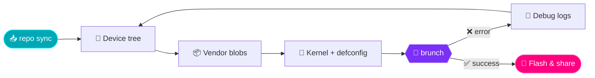

<p align="center">
  <picture>
    <source media="(prefers-color-scheme: dark)" srcset="https://readme-typing-svg.demolab.com?font=Fira+Code&weight=600&size=24&duration=2800&pause=700&color=00F7FF&center=true&vCenter=true&width=720&height=50&lines=%24+whoami+%E2%86%92+HiSiuDz+%F0%9F%91%BE;%24+repo+sync+-j8+%E2%86%92+syncing+the+universe;%24+lunch+lineage_device-userdebug;%24+brunch+%E2%86%92+it+builds%2C+ship+it+%F0%9F%9A%80;%24+echo+%22I+turn+coffee+into+code%22">
    
  </picture>
</p>

<p align="center">
  
  
  
  
</p>

<p align="center">
  <a href="https://t.me/noobbuildxyz"></a>
  <a href="https://t.me/HiSiuDz"></a>
</p>

<br>

## 👾 `neofetch`

```text
        .--.           HiSiuDz@github
       |o_o |          ─────────────────────────────
       |:_/ |          Location : Vietnam 🇻🇳
      //   \ \         Focus    : Android ROM / device trees
     (|     | )        Digging  : Linux & Android internals, C++
    /'\_   _/`\        Shell    : bash / zsh
    \___)=(___/        Editor   : VS Code, vim
                       Fuel     : coffee ☕ (unlimited)
                       Motto    : build. break. fix. repeat.
```

<br>

## ⚙️ How I Bring Up a ROM



<br>

## 🛠️ What I Do

<table align="center">
  <tr>
    <td align="center" width="33%">
      <h3>📱 Android ROM</h3>
      <sub>Device trees · vendor blobs<br>building & bringing up custom ROMs</sub>
    </td>
    <td align="center" width="33%">
      <h3>🐧 Linux & Kernel</h3>
      <sub>Low-level internals · kernel configs<br>build tooling & automation</sub>
    </td>
    <td align="center" width="33%">
      <h3>⚡ C / C++ / Bash</h3>
      <sub>System-level code · scripts<br>small, useful tools</sub>
    </td>
  </tr>
</table>

<br>

## 🧰 Tech Stack

<details open>
<summary><b>Languages</b></summary>
<br>
<p>
  
  
  
  
  
  
</p>
</details>

<details open>
<summary><b>Platforms & Tools</b></summary>
<br>
<p>
  
  
  
  
  
  
  
  
  
  
</p>
</details>

<br>

## 📊 Stats

<p align="center">
  <picture>
    <source media="(prefers-color-scheme: dark)" srcset="https://github-readme-stats.vercel.app/api?username=Huy7684&show_icons=true&hide_border=true&bg_color=0d1117&title_color=00F7FF&icon_color=FF0080&text_color=c9d1d9&ring_color=7B2FF7&include_all_commits=true">
    
  </picture>
  <picture>
    <source media="(prefers-color-scheme: dark)" srcset="https://github-readme-stats.vercel.app/api/top-langs/?username=Huy7684&layout=donut-vertical&hide_border=true&bg_color=0d1117&title_color=00F7FF&text_color=c9d1d9">
    
  </picture>
</p>

<p align="center">
  <picture>
    <source media="(prefers-color-scheme: dark)" srcset="https://streak-stats.demolab.com/?user=Huy7684&hide_border=true&background=0d1117&ring=FF0080&fire=FF6A00&currStreakLabel=00F7FF&currStreakNum=ffffff&sideNums=ffffff&sideLabels=c9d1d9&dates=8b949e">
    
  </picture>
</p>

<p align="center">
  <picture>
    <source media="(prefers-color-scheme: dark)" srcset="https://github-profile-trophy.vercel.app/?username=Huy7684&theme=onedark&no-frame=true&no-bg=true&margin-w=12&column=6">
    
  </picture>
</p>

<p align="center">
  <picture>
    <source media="(prefers-color-scheme: dark)" srcset="https://github-readme-activity-graph.vercel.app/graph?username=Huy7684&bg_color=0d1117&color=00F7FF&line=7B2FF7&point=FF0080&area=true&area_color=7B2FF7&hide_border=true">
    
  </picture>
</p>

<br>

<p align="center">
  <i>"Talk is cheap. Show me the code." — Linus Torvalds</i>
</p>


