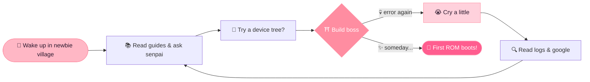

<p align="center">
  <picture>
    <source media="(prefers-color-scheme: dark)" srcset="https://readme-typing-svg.demolab.com?font=Fira+Code&weight=600&size=24&duration=2500&pause=600&color=FFB7C5&center=true&vCenter=true&width=760&height=50&lines=Konnichiwa%21+Watashi+wa+HiSiuDz+%28%E2%89%A7%E2%96%BD%E2%89%A6%29%2F;Just+a+noob+who+can%27t+build+ROMs+yet+%28%E3%83%BB%E3%83%BB%3B%29;Learning+everyday+...+Ganbarimasu%21+%E2%9C%A7;Senpai%2C+please+notice+my+code+%28%2F%E2%89%A7%E2%96%BD%E2%89%A6%29%2F">
    
  </picture>
</p>

<p align="center">
  
  
  
  
</p>

<p align="center">
  <a href="https://t.me/noobbuildxyz"></a>
  <a href="https://t.me/HiSiuDz"></a>
  <a href="https://github.com/WibuRachSapphireTree"></a>
</p>

<p align="center">🌸 ･ﾟ: *✧･ﾟ:* ✦ ･ﾟ: *✧･ﾟ:* ✦ ･ﾟ: *✧･ﾟ:* 🌸</p>

<p align="center"><b>「 初心者 」</b> — <i>shoshinsha</i>, a beginner<br>
<sub>♡ ゜･｡･ﾟ♡ Don't expect pro stuff here. I'm just a wibu noob trying my best ♡ ･ﾟ･｡･゜♡</sub></p>

<p align="center"></p>

```text
╔══════════════════════════════════════════════════╗
║   🌸 ═════════  S T A T U S  ═════════ 🌸        ║
╠══════════════════════════════════════════════════╣
║  Name     : HiSiuDz  (≧▽≦)/                      ║
║  Title    : 「ROM Build Noob」 初心者              ║
║  Level    : 1  (still grinding in the newbie     ║
║             village 🏘️)                           ║
║  Origin   : Vietnam 🇻🇳                            ║
║  Class    : Apprentice Wibu / Linux Learner      ║
║  Guild    : NoobBuild (Telegram) 🌸              ║
║  Weapons  : C · C++ · Bash · Python (wooden      ║
║             sword edition 🗡️)                     ║
║  Passive  : Turns coffee into bugs ☕💥           ║
║  Weakness : Build errors, red logs, sepolicy 💀  ║
║  Mood     : (；′⌒`) confused but never giving up ║
╚══════════════════════════════════════════════════╝
```

<p align="center">🌸 ･ﾟ: *✧･ﾟ:* ✦ ･ﾟ: *✧･ﾟ:* ✦ ･ﾟ: *✧･ﾟ:* 🌸</p>

<p align="center"></p>

<p align="center"><i>"Reincarnated as a noob who doesn't know how to build ROMs" (๑•́ ₃ •̀๑)</i></p>



<p align="center">🌸 ･ﾟ: *✧･ﾟ:* ✦ ･ﾟ: *✧･ﾟ:* ✦ ･ﾟ: *✧･ﾟ:* 🌸</p>

<p align="center"></p>

<table align="center">
  <tr>
    <td align="center" width="33%">
      <h3>📱 Android ROM</h3>
      <sub>Trying to learn device trees & vendor blobs<br>Can't build a ROM yet (´;ω;`)<br><b>Status: 🌱 just started</b></sub>
    </td>
    <td align="center" width="33%">
      <h3>🐧 Linux & Kernel</h3>
      <sub>Poking around the terminal<br>Breaking things, then fixing them<br><b>Status: 🌿 learning</b></sub>
    </td>
    <td align="center" width="33%">
      <h3>⚡ C / C++ / Bash</h3>
      <sub>Small scripts and tiny experiments<br>Copy, paste, understand (maybe)<br><b>Status: 🌸 practicing</b></sub>
    </td>
  </tr>
</table>

<p align="center">
  
  
  
  
</p>

<p align="center">🌸 ･ﾟ: *✧･ﾟ:* ✦ ･ﾟ: *✧･ﾟ:* ✦ ･ﾟ: *✧･ﾟ:* 🌸</p>

<p align="center"></p>

<p align="center">
  <a href="https://github.com/WibuRachSapphireTree">
    
  </a>
</p>

<p align="center"><sub>🌸 My little wibu tree, come visit and say hi~ (｡•̀ᴗ-)✧ 🌸</sub></p>

<p align="center">🌸 ･ﾟ: *✧･ﾟ:* ✦ ･ﾟ: *✧･ﾟ:* ✦ ･ﾟ: *✧･ﾟ:* 🌸</p>

<p align="center"></p>

<details open>
<summary><b>🌸 Languages (learning)</b></summary>
<br>
<p>
  
  
  
  
  
  
</p>
</details>

<details open>
<summary><b>🌸 Platforms & Tools (my starter pack)</b></summary>
<br>
<p>
  
  
  
  
  
  
  
  
  
</p>
</details>

<p align="center">🌸 ･ﾟ: *✧･ﾟ:* ✦ ･ﾟ: *✧･ﾟ:* ✦ ･ﾟ: *✧･ﾟ:* 🌸</p>

<p align="center"></p>

<p align="center">
  <picture>
    <source media="(prefers-color-scheme: dark)" srcset="https://streak-stats.demolab.com/?user=Huy7684&hide_border=true&background=1a1226&ring=FF5D8F&fire=FFB7C5&currStreakLabel=FFB7C5&currStreakNum=ffffff&sideNums=ffffff&sideLabels=ffd1dc&dates=d4a5b8">
    
  </picture>
</p>

<p align="center">
  <picture>
    <source media="(prefers-color-scheme: dark)" srcset="https://github-readme-stats.vercel.app/api?username=Huy7684&show_icons=true&hide_border=true&bg_color=1a1226&title_color=FFB7C5&icon_color=FF5D8F&text_color=ffffff">
    
  </picture>
</p>

<p align="center">
  
</p>

<p align="center">🌸 ･ﾟ: *✧･ﾟ:* ✦ ･ﾟ: *✧･ﾟ:* ✦ ･ﾟ: *✧･ﾟ:* 🌸</p>

<p align="center">
  <b>頑張って！ Ganbatte!</b> (ﾉ◕ヮ◕)ﾉ*:･ﾟ✧ 🌸<br>
  <i>"One day I'll build my very first ROM... that's my dream!" (๑˃̵ᴗ˂̵)و ♡</i><br>
  <sub>— HiSiuDz, level 1 noob</sub>
</p>


